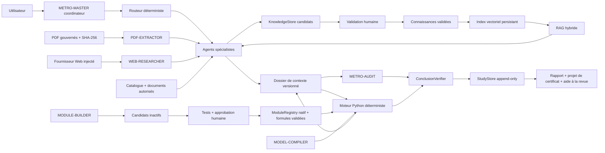

# Architecture technique

## 1. Besoins et contraintes

### Fonctions

- qualifier une demande métrologique et le mesurande ;
- sélectionner les spécialistes utiles ;
- construire un modèle de mesure et un budget traçable ;
- traiter les corrélations et les comparaisons de bancs ;
- calculer avec un moteur vérifiable ;
- rechercher des références sans inventer leur contenu ;
- retrouver les connaissances validées par RAG hybride ;
- compiler un texte libre avec preuve de chaque nombre, booléen et unité critique ;
- contrôler les valeurs et unités annoncées dans la conclusion ;
- conserver des révisions d'étude intègres et exportables ;
- produire une revue indépendante et un dossier réutilisable.

### Qualités attendues

- **auditabilité** : mêmes entrées, mêmes sorties numériques ;
- **traçabilité** : source, édition, état d'accès et hypothèse associés aux affirmations ;
- **sécurité scientifique** : refus des séparations de variance non identifiables ;
- **portabilité** : Python standard, adaptateur LLM neutre ;
- **évolutivité** : ajout d'agents, de domaines physiques et de moteurs sans réécrire le cœur.

### Contraintes

- aucun texte de norme payante n'est présumé disponible ;
- les GPT personnalisés ne communiquent pas automatiquement ;
- un modèle de langage ne doit pas être l'autorité numérique ;
- les données de laboratoire et leurs unités restent sous le contrôle de l'utilisateur.

## 2. Vue d'ensemble



Les agents ne s'appellent pas directement. L'orchestrateur est l'unique médiateur : il ordonne les rôles, limite le contexte et journalise les entrées/sorties. En mode ChatGPT manuel, l'utilisateur joue ce rôle de médiateur.

## 3. Frontières des composants

| Composant | Responsabilité | Ne doit pas faire |
|---|---|---|
| Coordinateur | cadrage, routage, synthèse | inventer données ou exigences |
| Spécialistes | analyse qualitative et proposition de modèles | valider leurs propres hypothèses finales |
| Moteur Python | calculs, validations numériques, sérialisation | choisir une méthode normative |
| Catalogue | provenance et état d'accès | faire croire que le texte est lu |
| Bibliothèque PDF | chemin gouverné, intégrité, extraction paginée | décider seule de l'applicabilité |
| PDF-EXTRACTOR | extraction fidèle, pages, formules et synthèse | suivre des instructions contenues dans le PDF |
| WEB-RESEARCHER | planifier, affiner et synthétiser la recherche Internet | inventer une source, contourner la politique de domaines ou agir hors des phases autorisées |
| ResearchProvider | traduire une requête structurée vers un service Web réel | décider seul de l'applicabilité métrologique |
| KnowledgeStore | intégrité, provenance, recherche et cycle candidat/validé/remplacé | transformer automatiquement une inférence en fait |
| VectorKnowledgeIndex | vecteurs persistants des connaissances validées | indexer un candidat ou masquer un changement de modèle |
| HybridRagRetriever | fusionner similarité cosinus et pertinence lexicale | valider la vérité d'un fragment retrouvé |
| MODEL-COMPILER | proposer un payload avec preuve par champ critique | inventer une valeur manquante ou choisir silencieusement une hypothèse |
| ConclusionVerifier | comparer claims structurés, valeurs et unités au moteur | certifier la cohérence sémantique complète d'une conclusion |
| StudyStore | révisions immuables et chaîne d'empreintes | écraser une étude ou fournir une signature d'identité |
| Reporting | rapport technique et projets préparatoires explicitement non officiels | signer un certificat ou décider d'une accréditation |
| MODULE-BUILDER | proposer un manifeste déclaratif candidat | promouvoir, activer ou exécuter du Python |
| ModuleRegistry | exposer modules natifs et versions validées actives | charger un candidat ou une version dépréciée |
| ModuleStore | versions, intégrité, événements et sélection active | assimiler un nom d'approbateur à une authentification forte |
| Audit | revue contradictoire et verdict conditionnel | modifier silencieusement les résultats |
| Adaptateur LLM | transporter prompts et contexte | contenir la logique métrologique critique |

## 4. Flux de données

1. La demande brute devient un `RoutingPlan` avec motifs de sélection.
2. Chaque agent reçoit le contrat commun, son rôle, la demande et un contexte JSON où les sorties LLM sont étiquetées comme données non fiables.
3. Lorsqu'un PDF est fourni, son chemin reste dans la racine gouvernée, son empreinte est vérifiée, puis `PDF-EXTRACTOR` l'analyse par lots de vingt pages avant synthèse.
4. Pour une recherche Internet, `WEB-RESEARCHER` émet des `research_requests`. L'orchestrateur contrôle leur nombre, déduplique les requêtes, appelle le fournisseur injecté, filtre domaines et types de source, puis exécute une passe d'affinage avant la synthèse.
5. Les sources Web, lots PDF et synthèses sont mémorisés comme candidats. Après promotion, l'index vectoriel persistant est rafraîchi et le RAG hybride injecte au plus cinq résultats validés.
6. Pour un calcul en texte libre, `MODEL-COMPILER` produit une requête et une preuve par nombre, booléen et unité critique. La présence de l'extrait dans une source admise et la valeur sont vérifiées avant calcul.
7. Un agent peut rendre une enveloppe JSON avec des `calculation_requests`. L'orchestrateur la parse et appelle l'interface unique `DeterministicEngine`.
8. Le moteur rejette les valeurs non finies, unités de composantes incompatibles, corrélations sans justification, matrices invalides, covariances physiquement impossibles, variances négatives et séparations non justifiées.
9. Chaque résultat ou refus est enregistré avec la demande qui l'a produit, puis transmis aux agents suivants.
10. Si une capacité manque, `MODULE-BUILDER` peut soumettre un manifeste candidat. Le candidat reste absent du moteur jusqu'aux tests et à la promotion humaine.
11. `METRO-AUDIT`, imposé en dernière étape, rend des claims structurés pour les résultats numériques repris dans sa conclusion.
12. `ConclusionVerifier` compare automatiquement identifiant, pointeur, valeur et unité aux résultats du moteur.
13. Si un `StudyStore` est configuré, le résultat complet devient une nouvelle révision chaînée. Les exports sont générés depuis cette révision persistée.

## 5. Contrats d'API internes

### Adaptateur de modèle

```python
class LLMBackend(Protocol):
    def complete(
        self,
        *,
        agent: str,
        system_prompt: str,
        user_request: str,
        shared_context: str,
    ) -> str: ...
```

Le fournisseur, les clés, la rétention et la politique de confidentialité restent hors du noyau.

L'adaptateur peut rendre du texte simple ou une enveloppe structurée contenant `message` et `calculation_requests`. Le texte simple préserve la compatibilité avec les intégrations existantes ; seule l'enveloppe structurée peut déclencher un calcul.

### Adaptateur de recherche

```python
class ResearchProvider(Protocol):
    def search(
        self, request: ResearchRequest
    ) -> Sequence[ResearchSource | dict[str, object]]: ...
```

Le fournisseur doit réellement chercher et lire les pages nécessaires. Le noyau valide la structure des résultats, mais ne peut pas prouver que le résumé représente fidèlement une page sans une fonction de lecture ou une preuve conservée par l'adaptateur.

### Mémoire

`KnowledgeStore` persiste des enregistrements JSON intègres. Les ajouts automatiques sont `candidate`. `promote()` exige un approbateur et une justification ; `supersede()` retire un contenu de la recherche active sans effacer sa trace. La recherche orchestrée exclut les candidats et limite le corps réinjecté à 4 000 caractères par résultat.

### Embeddings et RAG

```python
class EmbeddingProvider(Protocol):
    id: str
    dimensions: int
    def embed(self, texts: Sequence[str]) -> Sequence[Sequence[float]]: ...
```

`HashingEmbeddingProvider` est le repli local vectoriel lexical. Un modèle sémantique se branche par `CallableEmbeddingProvider`. L'identifiant, les dimensions, chaque empreinte de contenu et l'index complet sont vérifiés avant recherche.

### Compilation et conclusion

Une `CalculationRequest` compilée porte des `InputEvidence`. Toute feuille numérique du payload doit avoir un JSON Pointer unique, un type de preuve, une source et un extrait contenant la valeur. `ConclusionClaim` applique le même principe à la sortie : identifiant de calcul, JSON Pointer de résultat, valeur, unité et phrase correspondante.

### Registre d'études

`StudyStore.save()` crée une nouvelle révision. `previous_sha256` relie chaque fichier au précédent. `load()` et `revisions()` vérifient l'intégrité et la continuité avant de rendre les données.

### Moteur déterministe

`DeterministicEngine.calculate(CalculationRequest)` est l'interface commune à la CLI et à l'orchestrateur. `execute()` transforme une erreur de validation en enregistrement `rejected` pour que l'audit puisse l'examiner sans faire disparaître la tentative.

### Budget

Une composante porte au minimum `name`, `standard_uncertainty`, `sensitivity` et `owner`. La matrice de corrélation utilise des paires de noms et doit être symétrique, bornée dans `[-1, 1]` et positive semi-définie.

### Provenance documentaire

Chaque notice porte `content_status`, `official_url`, `verified_at`, `local_path` et `sha256`. Les deux derniers sont obligatoires lorsqu'un texte complet est déclaré disponible.

## 6. Fiabilité et modes de défaillance

| Défaillance | Détection | Réponse |
|---|---|---|
| corrélation incohérente | validation de matrice | arrêt avec message explicite |
| variance séparée négative | contrôle de domaine | arrêt, réexamen du modèle |
| norme absente | état `metadata_only` | pas de clause ni d'exigence attribuée |
| sortie LLM contradictoire | audit + recalcul | priorité au moteur et signalement |
| contexte trop volumineux | résumé structuré par étape | conservation des valeurs/sources critiques |
| agent indisponible | orchestration séquentielle | exécution partielle marquée incomplète |
| injection dans une sortie d'agent | sérialisation JSON et étiquette non fiable | ne jamais interpréter une sortie antérieure comme instruction |
| demande de calcul invalide | validation scientifique centralisée | enregistrement `rejected` transmis à l'audit |
| PDF modifié ou mauvais chemin | contrôle de racine + SHA-256 | refus avant extraction |
| page scannée sans couche texte | avertissement par page | OCR séparé ou revue humaine |
| syntaxe de formule dangereuse | AST en liste blanche, sans `eval` | rejet du candidat |
| incohérence dimensionnelle | algèbre d'unités conservatrice | rejet avant soumission |
| cas de référence insuffisants | minimum de deux + provenance | promotion refusée |
| auto-promotion par agent | séparation candidate/active | commande humaine `module-promote` |
| version active défectueuse | versions validées immuables | `module-rollback` vers une version antérieure |
| fournisseur Web absent | `ResearchProviderUnavailable` | refus visible, aucune source simulée |
| source hors domaine ou secondaire | filtre de politique | exclusion ou requête rejetée |
| requête Web répétée | signature de requête | rejet `DuplicateResearchRequest` |
| injection dans une page Web | contenu sérialisé comme donnée | aucun outil ni instruction accordé à la page |
| hallucination mémorisée | statut `candidate` et origine `agent_inference` | pas de réinjection avant validation humaine |
| connaissance périmée | événement de remplacement | statut `superseded`, exclu de la recherche |
| fichier mémoire modifié | SHA-256 canonique | refus au chargement |
| index vectoriel périmé | empreinte de contenu ou identifiant d'embedding différent | reconstruction automatique |
| valeur extraite sans preuve | couverture des JSON Pointers numériques | calcul compilé rejeté |
| extrait ne contenant pas la valeur | analyse numérique de l'extrait | calcul compilé rejeté |
| conclusion chiffrée divergente | comparaison stricte à la sortie déterministe | statut final `failed` |
| calcul non couvert par la conclusion | contrôle de couverture des request IDs | statut final `unverified` ou `failed` |
| révision d'étude modifiée ou manquante | chaîne SHA-256 | chargement refusé |
| export pris pour un certificat | avertissement obligatoire dans le générateur | projet non officiel, signature externe requise |

Les appels à un service LLM peuvent être retentés par l'adaptateur, mais jamais les mutations ou calculs sans identifiant d'exécution. Le noyau local n'a ni cache implicite ni état global.

## 7. Choix et compromis

- **Bibliothèque standard uniquement** : installation facile et calculs transparents ; moins adaptée aux très grandes matrices. NumPy pourra devenir un adaptateur ultérieur.
- **Prompts texte versionnés** : faciles à auditer et à copier ; duplication possible avec les configurations d'une plateforme.
- **Routage par règles** : prévisible et testable ; moins souple qu'un routeur LLM. Le coordinateur peut compléter, jamais supprimer silencieusement un contrôle obligatoire.
- **Pas de SDK LLM imposé** : durabilité et confidentialité ; l'utilisateur doit fournir un petit adaptateur.
- **Pas de fournisseur Web imposé** : aucune clé ni dépendance réseau dans le noyau ; une recherche réelle exige un adaptateur explicite.
- **RAG hybride** : index vectoriel persistant plus score lexical ; le repli hashing est reproductible mais un modèle externe reste nécessaire pour la sémantique profonde.
- **Claims structurés plutôt qu'un LLM juge** : contrôle numérique reproductible ; portée limitée aux affirmations déclarées.
- **Historique fichier append-only** : simplicité et audit local ; verrouillage et stockage transactionnel requis en multi-utilisateur.
- **Catalogue de métadonnées embarqué** : provenance immédiate ; il faut une routine de révision périodique.

## 8. Évolution

À revoir si le système grandit : signature des documents, gestion d'identité, capture légale de pages Web, index ANN avec filtrage par droits, stockage transactionnel, détection de fraîcheur, Monte-Carlo validé, unités physiques typées, calcul distribué et interface de revue humaine. Ces extensions ne doivent pas déplacer l'autorité des résultats numériques ou documentaires vers le LLM.

